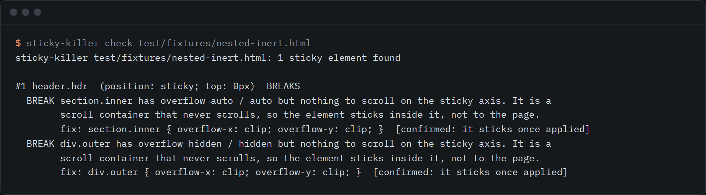

# sticky-killer

Names the ancestor element that breaks position: sticky, as a devtools snippet, bookmarklet and extension.



```sh
npx github:rishsadh/sticky-killer check page.html
```

Add a URL instead of a file if you like. It loads the page in a headless Chrome or Edge you already have, finds every sticky element, and tells you which ancestor stops each one. It then applies the fix in memory, scrolls, and measures whether the element now sticks. The repo has no dependencies.

## Why this exists

On 30 Sep 2026 I searched GitHub and npm for a tool that finds the ancestor breaking `position: sticky` and found none (queries: "sticky debugger", "css sticky debug", "position sticky bookmarklet", "sticky overflow ancestor"; the closest hit was a 2017 sticky-viewport bookmarklet that does something else). The question itself is old. A Stack Overflow thread on sticky failing inside an overflow ancestor was reported to have 59,000 views when I logged the idea (Stack Overflow blocks automated fetching, so I did not re-read that count): https://stackoverflow.com/questions/51792783/safari-positionsticky-not-working-in-an-overflowauto-element

I hit the same wall while rebuilding scroll sections on my own site. The answer is almost always "some ancestor has overflow set", and finding which one means clicking up the tree in DevTools and reading computed styles by hand.

## Use it

Pick whichever fits. All four run the same code.

| Way | How |
|---|---|
| CLI, on a file or URL | `npx github:rishsadh/sticky-killer check page.html` (add `--json`, `--no-verify`, `--viewport 1280x900`, `--chrome PATH`) |
| DevTools snippet | `npx github:rishsadh/sticky-killer snippet`, paste into Sources > Snippets, run it on the page |
| Bookmarklet | `npx github:rishsadh/sticky-killer bookmarklet`, make a bookmark and paste the output as its URL (about 28 KB) |
| Chrome extension | `npx github:rishsadh/sticky-killer extension ./sticky-killer-ext`, then chrome://extensions, Developer mode, Load unpacked. Not in the Chrome Web Store |

In a browser, the snippet, bookmarklet and extension outline each sticky element (solid) and each blocking ancestor (dashed), print a report to the console, and open a small panel. The panel can preview a fix on the live page and undo it. Close puts every outline and change back.

`check` exits 1 when something is blocked, 0 when not, 2 on an error, so you can run it in CI against built HTML.

## What it checks

For each visible element with `position: sticky` (shadow DOM included):

- **No inset.** None of top, bottom, left or right is set, so sticky does nothing.
- **A scroll container that never scrolls.** The nearest ancestor with overflow hidden, scroll, auto or overlay becomes the thing the element sticks to. If it has nothing to scroll, the element is pinned to a box that never moves. Every such ancestor is listed, nearest first. Body is handled the way the CSS spec does: its overflow passes to the viewport unless html sets overflow too.
- **No room in the parent.** The element sits at the edge of its parent, including a flex or grid child stretched to full height.
- **Notes.** A real scroller that the element sticks inside (works as designed, just not to the page), and a hidden-overflow box whose content runs past the edge.

The suggested fix is usually `overflow: clip`, which clips like `hidden` but does not create a scroll container. Check that your target browsers support it before shipping.

## What actually breaks sticky

I measured this instead of repeating it. `research/measure-breakers.mjs` styles one ancestor at a time, scrolls, and records whether a sticky element pins to the top of the viewport. Run on 30 Sep 2026 with Playwright on Windows. The WebKit row is Playwright's WebKit build, not Safari itself.

| Setup | Chromium 151.0.7922.34 | WebKit 26.6 |
|---|---|---|
| baseline (no ancestor styling) | sticks | sticks |
| overflow: hidden | **breaks** | **breaks** |
| overflow: auto | **breaks** | **breaks** |
| overflow: scroll | **breaks** | **breaks** |
| overflow: overlay | **breaks** | **breaks** |
| overflow: clip | sticks | sticks |
| overflow-x: hidden | **breaks** | **breaks** |
| overflow-x: clip | sticks | sticks |
| overflow-y: hidden | **breaks** | **breaks** |
| overflow-x: clip + overflow-y: visible | sticks | sticks |
| contain: paint | sticks | sticks |
| contain: layout | sticks | sticks |
| contain: strict | sticks | sticks |
| contain: content | sticks | sticks |
| content-visibility: auto | sticks | sticks |
| transform: translateZ(0) | sticks | sticks |
| filter: blur(0) | sticks | sticks |
| backdrop-filter: blur(1px) | sticks | sticks |
| perspective: 100px | sticks | sticks |
| will-change: transform | sticks | sticks |
| opacity: 0.99 | sticks | sticks |
| position: relative | sticks | sticks |
| position: absolute | sticks | sticks |
| isolation: isolate | sticks | sticks |
| clip-path: inset(0) | sticks | sticks |
| container-type: inline-size | sticks | sticks |
| display: flow-root | sticks | sticks |
| display: contents | sticks | sticks |
| html + body both overflow-x: hidden (body becomes the scroll container) | **breaks** | **breaks** |
| only body overflow-x: hidden (propagates to the viewport) | sticks | sticks |
| only html overflow-x: hidden (applies to the viewport) | sticks | sticks |
| no inset (top/bottom/left/right all auto) | **breaks** | **breaks** |
| parent is exactly as tall as the sticky element | **breaks** | **breaks** |
| flex parent, child stretched by align-items: stretch | **breaks** | **breaks** |
| flex parent with align-self: flex-start on the sticky child | sticks | sticks |

The second half of the table matters as much as the first: transform, filter, contain, will-change, perspective and the other usual suspects did not break sticky in either engine. Only `overflow` (other than `visible` or `clip`), a missing inset and a parent with no room did. Firefox is not measured here. Raw results: `research/breakers-chromium.json` and `research/breakers-webkit.json`.

## What it does not do

- **Not a Safari or Firefox test.** The CLI and extension need Chrome or Edge. The snippet and bookmarklet run in any browser that supports them, but the measurements above cover Chromium and WebKit only.
- **`check` works on static HTML.** It loads a copy of the page from a temporary file with a `<base>` tag, and removes any CSP meta tag so the script can run. Pages that need a login, cookies or same-origin API calls may render differently. Use the snippet or bookmarklet inside your own browser for those.
- **Top frame only.** Sticky elements inside iframes are not inspected.
- **The scroll probe moves the page** and restores the position afterwards. Pages that react to scroll with script (hide-on-scroll headers, for example) can look like they "engage" when sticky is not the cause.
- **A page too short to scroll** is reported as not measured, not as broken.
- **The extension toolbar click was not automated.** The extension loads in Chromium with no errors and ships the same tested bundle as the snippet, but I clicked nothing in the toolbar.
- It does not edit your CSS. It prints the fix.

## Develop

```sh
npm test      # unit tests on a fake DOM, plus end-to-end runs in headless Chrome (skipped if none is found)
npm run build # rebuild dist/ and extension/sticky-killer.js from src/
```

Set `CHROME_PATH` if Chrome or Edge is not found, and `STICKY_KILLER_NO_SANDBOX=1` on a CI box that cannot sandbox it.

## Licence

MIT. By [@rishsadh](https://github.com/rishsadh).
